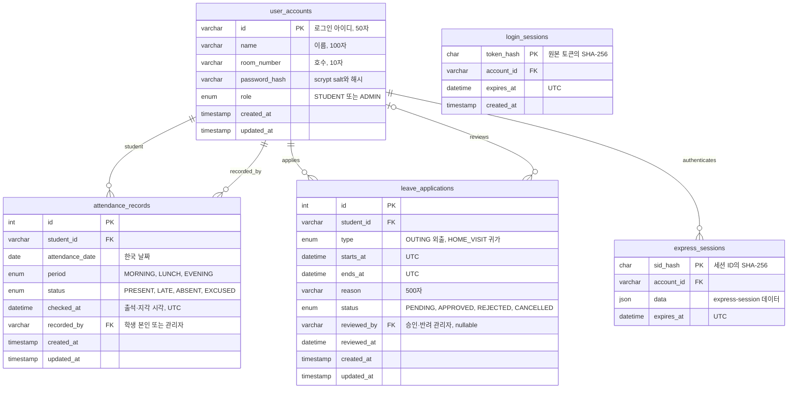

# 데이터베이스 설계

| 기존 / 추가 | 사용하는 이름 | 의미 |
| --- | --- | --- |
| `users` | `user_accounts` | 학생/관리자 계정, 이름, 호수, 비밀번호 해시 |
| 없음 | `attendance_records` | 날짜·시간대별 출결 기록 |
| `home_stay`, `leave_requests`의 겹치는 외출·귀가 신청 | `leave_applications` | 신청 유형, 기간, 승인 상태 |
| 없음 | `login_sessions` | 기존 토큰 세션 데이터 보존용 (인증에는 사용하지 않음) |
| 없음 | `express_sessions` | 현재 `express-session`의 MySQL 저장소. 기존 토큰 세션은 사용하지 않음 |

## 이렇게 나눈 이유

계정에 출결 값 하나만 두면 날짜별 이력이 덮어써집니다. 출결은 별도 테이블에 저장하고 `(student_id, attendance_date, period)`를 유일하게 만들어 동일 시간대의 중복 제출을 DB에서 막습니다. 호수는 계정에서 조회하므로 여러 기록에 같은 값을 복사하지 않습니다. 현재 구조에서 과거 기록에 표시되는 호수는 학생의 현재 호수입니다. 호실 이동 이력이 필요해지면 별도 입실 이력 테이블을 추가할 수 있습니다.

외출과 귀가는 기간과 승인 절차가 같으므로 테이블을 나누지 않고 `type`으로 구분합니다. `status`는 승인·반려·취소 상태이므로 신청 유형과 별도입니다. `ends_at > starts_at`을 DB에서 검사하고 API는 학생별 잠금과 트랜잭션으로 겹치는 대기/승인 신청을 막습니다. 종료와 다음 신청 시작이 같은 경우는 허용합니다.

비밀번호 평문과 세션 ID 원문은 DB에 저장하지 않습니다. 계정의 비밀번호 해시는 기존 scrypt 형식을 유지합니다. `express-session`의 세션을 MySQL에 저장해 로그아웃 시 즉시 무효화하고 재시작 후에도 인증 상태를 확인합니다. 기존 `login_sessions`는 보존하지만 인증에는 사용하지 않습니다.

학생 이력의 외래 키는 계정 삭제 시 기록이 함께 사라지지 않도록 제한합니다. 세션만 계정 삭제 시 함께 삭제합니다. 관리자 여부는 클라이언트 입력이 아니라 DB 계정 역할로 판단합니다.

`schema_migrations`는 적용 버전을 관리하는 내부 테이블입니다. 기존 DB의 `legacy_home_stay`, `legacy_leave_requests`는 보존용 테이블이며 새 API의 ERD에는 포함하지 않았습니다. `home_stay.choice`의 잔류 선택은 외출·귀가 신청과 다른 의미라 임의로 변환하지 않습니다. 잔류 선택 기능이 필요하면 별도 요구사항으로 설계합니다.

초기 생성 SQL: [001_initial.sql](../src/database/001_initial.sql). `express_sessions` 테이블은 [migrate.js](../src/database/migrate.js)의 002 마이그레이션에서 생성합니다. MySQL의 CHECK 제약은 8.0.16 이상에서 적용됩니다. [MySQL 공식 문서](https://dev.mysql.com/doc/refman/8.0/en/create-table-check-constraints.html)
